# Documentação — Relatórios semanais de PoCs com CrewAI

> Documento de referência do projeto `poc-reports`: objetivo, arquitetura, funcionamento interno,
> configuração, decisões tomadas e histórico de implementação.
> Para começar a usar rapidamente, veja o [README](../README.md).

## Sumário

1. [Objetivo](#1-objetivo)
2. [Visão geral da arquitetura](#2-visão-geral-da-arquitetura)
3. [Fluxo de uma execução semanal](#3-fluxo-de-uma-execução-semanal)
4. [Módulos do código](#4-módulos-do-código)
5. [Coleta de dados](#5-coleta-de-dados)
6. [O crew: agentes e tarefas](#6-o-crew-agentes-e-tarefas)
7. [Por que os agentes não usam ferramentas (tools)?](#7-por-que-os-agentes-não-usam-ferramentas-tools)
8. [Relatório gerado e issue de revisão](#8-relatório-gerado-e-issue-de-revisão)
9. [GitHub Actions](#9-github-actions)
10. [Provedor de LLM](#10-provedor-de-llm)
11. [Configuração](#11-configuração)
12. [Privacidade e segurança](#12-privacidade-e-segurança)
13. [Limites e orçamento de tokens](#13-limites-e-orçamento-de-tokens)
14. [Solução de problemas](#14-solução-de-problemas)
15. [Histórico do que foi feito](#15-histórico-do-que-foi-feito)
16. [Limitações conhecidas e próximos passos](#16-limitações-conhecidas-e-próximos-passos)

---

## 1. Objetivo

A consultoria mantém várias PoCs em paralelo e precisa enviar **toda semana** a cada cliente um
relatório de andamento. Escrever esses relatórios à mão é repetitivo e depende de alguém lembrar o que
aconteceu em cada repositório.

Este projeto automatiza o **primeiro rascunho**:

- lê o que aconteceu na semana nos repositórios de cada PoC (commits, PRs, issues e documentação);
- usa um **crew do CrewAI** com dois agentes para transformar essa atividade em um relatório para o cliente;
- salva o relatório no repositório e abre uma **issue de revisão** para o responsável ajustar o texto
  antes de enviar.

O relatório **nunca é enviado automaticamente ao cliente**: a revisão humana é parte do processo.

---

## 2. Visão geral da arquitetura

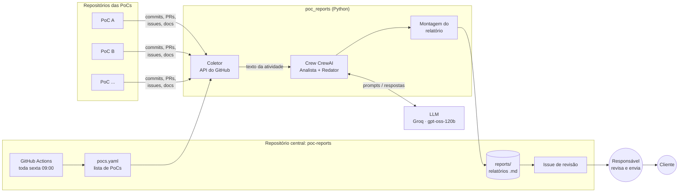

**Princípios do desenho:**

| Princípio | Como aparece no projeto |
|---|---|
| Coleta determinística, escrita pelo LLM | O Python busca os dados; o LLM só interpreta e redige |
| Um repositório central | As PoCs não precisam de nenhuma configuração ou arquivo novo |
| Humano no circuito | Todo relatório é rascunho e passa por uma issue de revisão |
| Provedor de LLM trocável | Modelo, endpoint e chave vêm de variáveis de ambiente |
| Custo zero para começar | Groq gratuito + GitHub Actions |

---

## 3. Fluxo de uma execução semanal

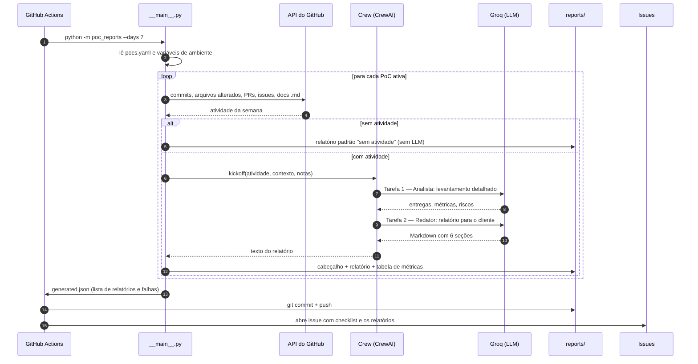

Se uma PoC falha (repositório inacessível, erro do LLM), as demais continuam. A falha aparece na issue
de revisão, na seção **⚠️ Falhas**.

---

## 4. Módulos do código

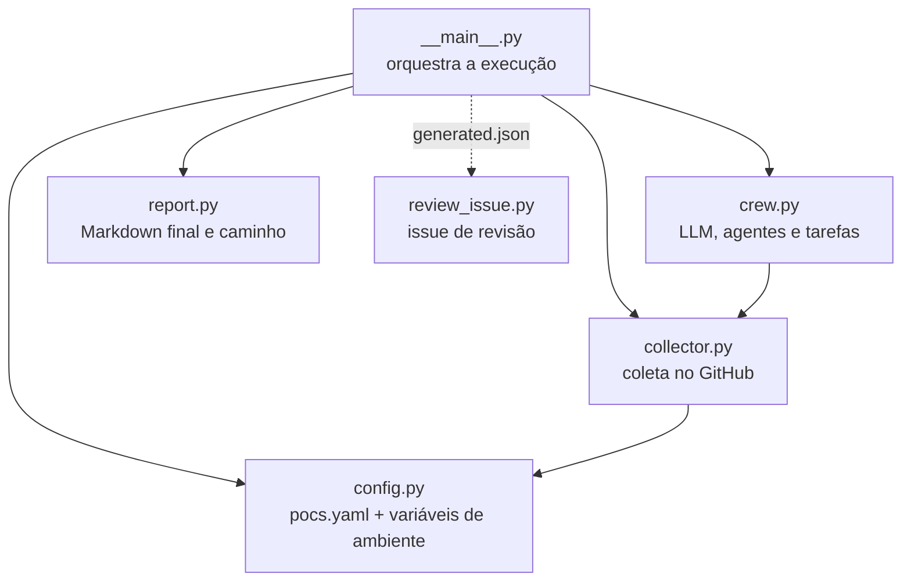

| Arquivo | Responsabilidade |
|---|---|
| `pocs.yaml` | Cadastro das PoCs (cliente, repositórios, contexto, responsável, notas) |
| `poc_reports/config.py` | Lê o `pocs.yaml` (dataclass `Poc`) e as variáveis de ambiente (`Settings`) |
| `poc_reports/collector.py` | Busca e compacta a atividade da semana (`PocActivity.to_prompt_text()`) |
| `poc_reports/crew.py` | Cria o LLM, os dois agentes, as duas tarefas e executa o crew |
| `poc_reports/report.py` | Monta o Markdown final, calcula o caminho `reports/<cliente>/<poc>/<semana>.md` |
| `poc_reports/__main__.py` | CLI: laço pelas PoCs, tratamento de erro por PoC, `--dry-run`, manifesto |
| `poc_reports/review_issue.py` | Lê o manifesto e abre a issue de revisão no repositório central |
| `.github/workflows/weekly-report.yml` | Agendamento, instalação, execução, commit e issue |

**Opções da linha de comando** (`python -m poc_reports`):

| Opção | Padrão | Uso |
|---|---|---|
| `--days N` | 7 | Tamanho do período analisado |
| `--poc TEXTO` | todas | Gera só as PoCs cujo nome contém o texto |
| `--config` | `pocs.yaml` | Arquivo de PoCs |
| `--out` | `reports` | Pasta de saída |
| `--manifest ARQ` | — | Grava a lista de relatórios gerados (usada pela issue) |
| `--dry-run` | — | Só coleta e imprime o texto que iria para o LLM |

---

## 5. Coleta de dados

A coleta é feita em Python puro com a biblioteca **PyGithub**, sem LLM. Para cada repositório da PoC:

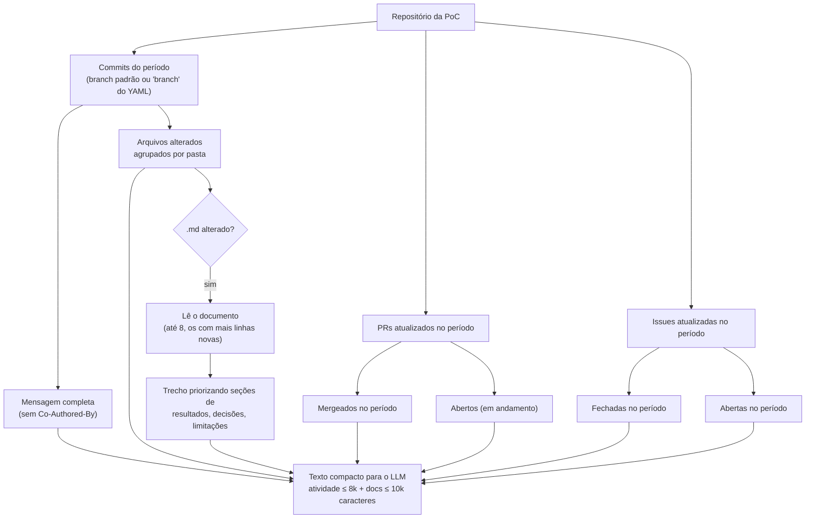

### O que é coletado

| Dado | Detalhe |
|---|---|
| Commits | Data, autor e mensagem completa (até 1.000 caracteres). Commits de merge são ignorados (o PR já aparece) |
| Arquivos alterados | Por commit, agrupados por pasta de primeiro nível: `docs/ (75 arq., +10275/-0)`. Até 30 commits detalhados |
| PRs | Número, título e início da descrição (200 caracteres, sem comentários de template) |
| Issues | Número, título e, para as abertas, início da descrição |
| Documentação | Trechos dos `.md` criados ou alterados no período (desligável com `incluir_docs: false`) |

### Como o trecho de cada documento é escolhido

Documentos técnicos costumam começar com informações operacionais (script, ambiente, como rodar) e só
depois trazer os resultados. Para não gastar o orçamento de caracteres com isso, o coletor:

1. divide o documento por títulos (`#`, `##`, `###`);
2. **descarta** seções como *Como reproduzir*, *Artefatos*, *Ambiente*, *Instalação*, *Estrutura*;
3. coloca **primeiro** as seções cujo título fala de *Resultados*, *Métricas*, *Indicadores*,
   *Conclusões*, *Decisões*, *Limitações*, *Próximos passos*, *Riscos*, *Objetivo*, *Resumo*;
4. preenche o espaço do documento (10.000 caracteres divididos entre os documentos) nessa ordem.

### Métricas calculadas pelo código

A tabela de métricas no fim de cada relatório é calculada pelo Python, **não pelo LLM**, para ser
sempre exata: commits, arquivos alterados, PRs mergeados e abertos, issues fechadas e abertas, contribuidores.

---

## 6. O crew: agentes e tarefas

O crew usa **processo sequencial** com dois agentes. A saída da primeira tarefa vira contexto da segunda.

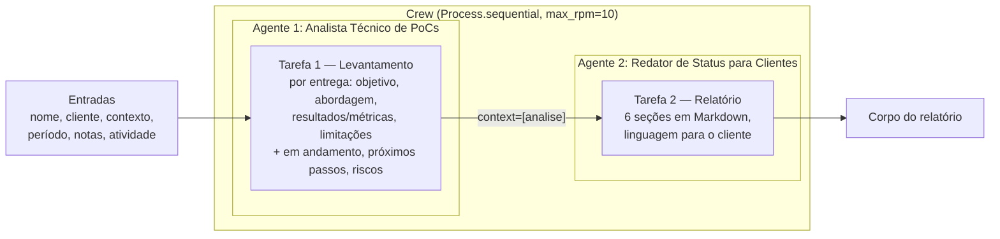

| | Analista Técnico de PoCs | Redator de Status para Clientes |
|---|---|---|
| **Papel** | Tech lead que lê commits, PRs, issues e docs | Gerente de projetos que escreve para o cliente |
| **Objetivo** | Levantamento detalhado e fiel do que foi entregue | Relatório detalhado, claro e fiel aos fatos |
| **Recebe** | Dados brutos da semana + contexto da PoC | O levantamento do analista |
| **Produz** | Lista estruturada por entrega | Markdown com as 6 seções |
| **Regras** | Ignorar ruído; não afirmar nada fora dos dados | Não inventar fatos; marcar sugestões com "(sugestão)"; sem nomes de arquivos |
| **Configuração** | `allow_delegation=False`, `max_iter=3` | `allow_delegation=False`, `max_iter=3` |

**Por que dois agentes e não um?** Separar "entender" de "escrever" melhora os dois: o analista se
concentra em extrair fatos e números; o redator, em clareza e tom para o cliente. Também facilita
ajustar um sem mexer no outro (por exemplo, mudar o tom do relatório sem afetar a extração).

---

## 7. Por que os agentes não usam ferramentas (tools)?

O CrewAI **tem** ferramentas: agentes podem receber *tools* (do pacote `crewai-tools` ou criadas com o
decorador `@tool` / classe `BaseTool`) e decidir sozinhos quando chamá-las. Existe, por exemplo, um
`GithubSearchTool` (busca semântica em repositórios) e ferramentas de leitura de arquivos e sites.

Neste projeto, **a coleta foi feita fora dos agentes, de propósito**:

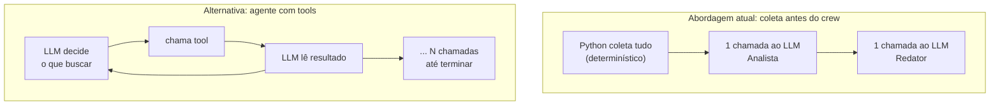

| Critério | Coleta em Python (atual) | Agente com tools |
|---|---|---|
| Chamadas ao LLM por PoC | 2 | Variável (cada uso de tool é mais uma chamada com todo o histórico) |
| Cabe no tier gratuito (8k tokens/min) | Sim | Difícil: o histórico cresce a cada chamada |
| Previsibilidade | Sempre coleta a mesma coisa | O modelo pode esquecer de buscar algo ou buscar demais |
| Confiabilidade com modelos menores | Alta | Modelos menores erram mais o formato de chamada de tool |
| Testabilidade | `--dry-run` mostra exatamente o que o LLM vê | Depende do que o agente decidir em cada execução |
| Flexibilidade | Só vê o que o coletor buscou | Pode investigar algo específico sob demanda |

**Resumo:** para um relatório *semanal e padronizado*, saber de antemão o que coletar é uma vantagem, e o
limite de tokens do tier gratuito pesa muito contra o modelo de tools.

**Onde tools fariam sentido (evolução possível):** dar ao Analista uma ferramenta específica, por
exemplo `ler_documento(caminho)`, para ele buscar sob demanda um documento que ficou de fora do
orçamento. Isso resolveria casos como o do projeto p03 no teste, cujos resultados ficaram cortados. É uma
mudança pequena e localizada em `crew.py`, mas aumenta o consumo de tokens e combina melhor com um
provedor pago.

---

## 8. Relatório gerado e issue de revisão

### Onde fica

```
reports/
└── <cliente>/            ex.: teste-interno
    └── <poc>/            ex.: pdi-2026
        └── <ano>-W<semana>.md   ex.: 2026-W46.md  (semana ISO)
```

Rodar de novo na mesma semana **sobrescreve** o arquivo daquela semana.

### Estrutura do relatório

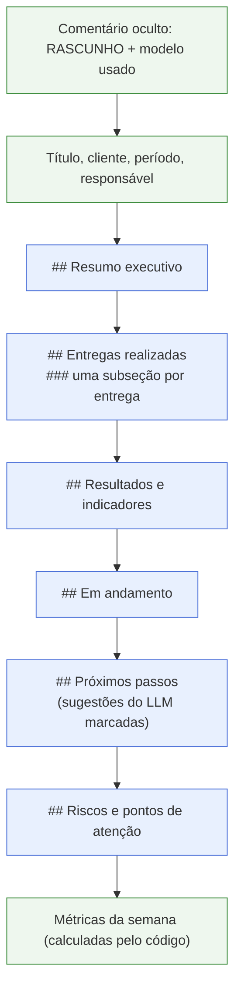

Em azul, o que o LLM escreve; em verde, o que o código gera.

### Semana sem atividade

Se nenhum repositório da PoC teve commits, PRs ou issues no período, o relatório é gerado **sem chamar o
LLM**, com o texto padrão "Não houve atividade registrada" e esse fato listado como ponto de atenção.

### Issue de revisão

Depois do commit dos relatórios, `review_issue.py` abre uma issue no repositório central com:

- um **checklist** com um item por relatório (link para o arquivo);
- a seção **⚠️ Falhas**, se alguma PoC falhou;
- a menção aos responsáveis (`responsavel_github`);
- o **texto completo** de cada relatório em blocos recolhíveis, para revisar sem sair da issue.

Fluxo de revisão sugerido:

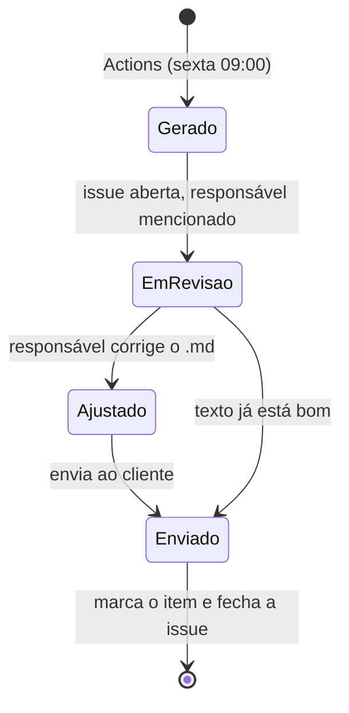

---

## 9. GitHub Actions

Arquivo: `.github/workflows/weekly-report.yml`.

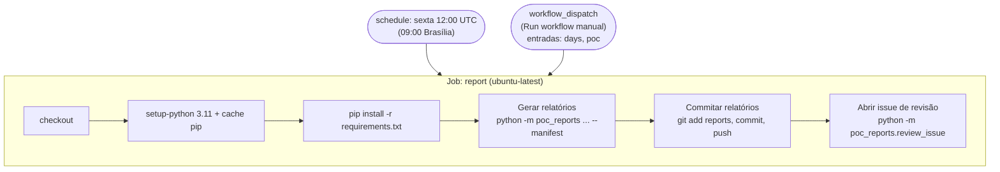

| Item | Valor |
|---|---|
| Permissões | `contents: write` (commit), `issues: write` (issue) |
| Concorrência | Grupo `weekly-report`: duas execuções nunca rodam ao mesmo tempo |
| Entradas manuais | `days` (padrão 7) e `poc` (filtro por nome) |
| Segurança | As entradas manuais chegam ao shell por variável de ambiente, não interpoladas no script |
| Duração típica | 3 a 5 minutos (a maior parte é a instalação do CrewAI) |

### Secrets e variáveis do repositório

| Nome | Tipo | Obrigatório | Uso |
|---|---|---|---|
| `LLM_API_KEY` | Secret | Sim | Chave do provedor de LLM (Groq) |
| `POC_GITHUB_TOKEN` | Secret | Só para repositórios privados | Token com leitura nos repositórios das PoCs |
| `LLM_MODEL` | Variable | Não | Troca o modelo (padrão `openai/openai/gpt-oss-120b`) |
| `LLM_BASE_URL` | Variable | Não | Troca o endpoint (padrão Groq) |
| `GITHUB_TOKEN` | Automático | — | Fornecido pelo Actions; usado para commit, issue e leitura de repositórios públicos |

---

## 10. Provedor de LLM

O CrewAI 1.x usa clientes nativos por provedor. Com `custom_openai=True` e uma `base_url`, ele usa o
cliente compatível com OpenAI, o que permite apontar para qualquer provedor com API no formato OpenAI.

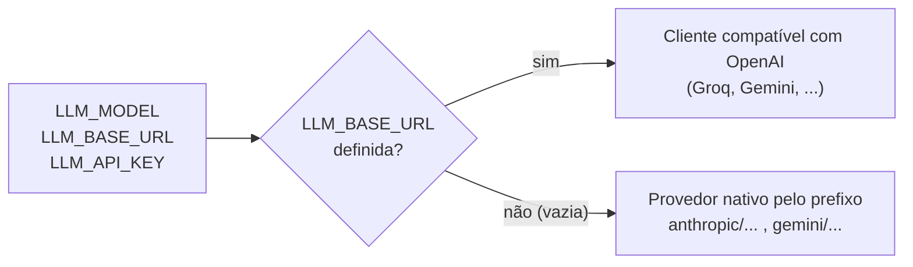

**O prefixo do modelo:** em `openai/openai/gpt-oss-120b`, o primeiro `openai/` diz ao CrewAI "use o
cliente compatível com OpenAI" e é removido; o restante, `openai/gpt-oss-120b`, é o id do modelo no Groq.

| Provedor | `LLM_MODEL` | `LLM_BASE_URL` | Observação |
|---|---|---|---|
| **Groq (padrão)** | `openai/openai/gpt-oss-120b` | `https://api.groq.com/openai/v1` | Gratuito, 8k tokens/min |
| Gemini | `openai/gemini-2.5-flash` | `https://generativelanguage.googleapis.com/v1beta/openai/` | Gratuito; o Google pode usar os dados no tier gratuito |
| Claude | `anthropic/claude-haiku-4-5-20251001` | *(vazio)* | Pago; requer `crewai[anthropic]` |

Configurações fixas do LLM: `temperature=0.2` (texto mais consistente) e `max_retries=6` (tenta de novo
quando o limite por minuto estoura).

### Histórico de provedores

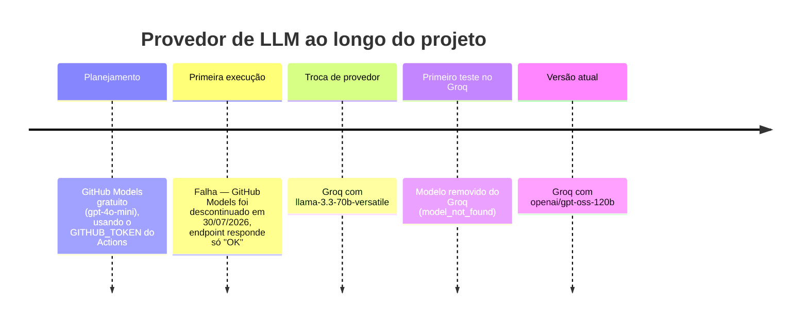

---

## 11. Configuração

### `pocs.yaml`

```yaml
pocs:
  - nome: "PoC Chatbot Atendimento"        # obrigatório
    cliente: "Cliente X"                   # obrigatório
    repos:                                 # obrigatório
      - "consultoria/chatbot-api"
      - "consultoria/chatbot-front"
    contexto: >                            # recomendado: objetivo e critério de sucesso
      Validar atendimento automatizado com RAG sobre a base de FAQs.
    responsavel: "Fulano"
    responsavel_github: "fulano"           # mencionado na issue de revisão
    branch: "develop"                      # opcional (padrão: branch padrão do repo)
    notas: "Cliente atrasou o acesso à base de FAQs."  # o que não aparece no GitHub
    incluir_docs: true                     # opcional (padrão: true)
    ativo: true                            # false pausa a PoC sem removê-la
```

| Campo | Efeito no relatório |
|---|---|
| `contexto` | O LLM relaciona o progresso com o objetivo da PoC. É o campo que mais melhora a qualidade |
| `notas` | Informa bloqueios, reuniões e decisões que não estão no GitHub |
| `incluir_docs` | Com `false`, não envia trechos de `.md` ao LLM (útil para PoCs sensíveis) |

### Variáveis de ambiente

| Variável | Padrão | Função |
|---|---|---|
| `LLM_API_KEY` | — | Chave do provedor de LLM (obrigatória, exceto no `--dry-run`) |
| `LLM_MODEL` | `openai/openai/gpt-oss-120b` | Modelo |
| `LLM_BASE_URL` | `https://api.groq.com/openai/v1` | Endpoint; vazio = provedor nativo |
| `POC_GITHUB_TOKEN` | — | Token de leitura das PoCs (tem prioridade sobre `GITHUB_TOKEN`) |
| `GITHUB_TOKEN` | — | Token GitHub; no Actions, também usado para a issue |

---

## 12. Privacidade e segurança

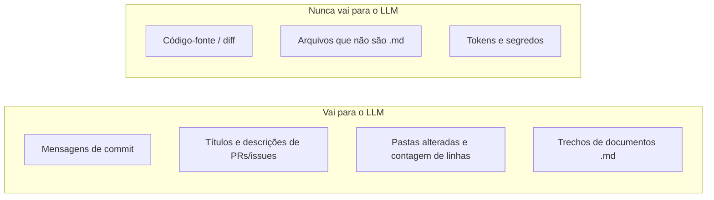

- **Código-fonte nunca é enviado.** Documentação em Markdown é enviada, a menos que `incluir_docs: false`.
- **Verifique os contratos/NDA** de cada cliente antes de incluir a PoC: os dados acima saem para o
  provedor de LLM. Tiers gratuitos podem ter políticas de uso de dados menos restritivas.
- **Deixe o repositório central privado.** Os relatórios ficam commitados nele.
- **Credenciais só em Secrets.** Nunca em `pocs.yaml`, no código ou em mensagens. O `.env` está no `.gitignore`.
- **Token de leitura mínimo:** o `POC_GITHUB_TOKEN` só precisa de leitura em *Contents*, *Pull requests*
  e *Issues* dos repositórios das PoCs.
- **Nada é enviado ao cliente automaticamente.**

---

## 13. Limites e orçamento de tokens

O tier gratuito do Groq para o `gpt-oss-120b` permite **8.000 tokens por minuto** (entrada + saída) e
1.000 requisições por dia (valores lidos dos cabeçalhos da API em 10/11/2026; podem mudar).

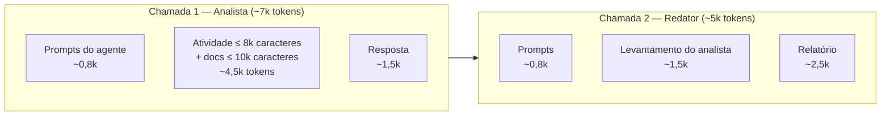

| Mecanismo | Valor | Onde |
|---|---|---|
| Limite de atividade | 8.000 caracteres | `MAX_ACTIVITY_CHARS` em `collector.py` |
| Limite de documentação | 10.000 caracteres, divididos entre até 8 documentos | `MAX_DOCS_CHARS`, `MAX_DOCS` |
| Mensagem de commit | 1.000 caracteres | `MAX_COMMIT_MESSAGE_CHARS` |
| Commits com lista de arquivos | 30 | `MAX_COMMITS_WITH_FILES` |
| Requisições por minuto do crew | 10 | `max_rpm` em `crew.py` |
| Novas tentativas em erro 429 | 6 | `max_retries` em `crew.py` |
| Pausa entre PoCs | 5 segundos | `__main__.py` |

As duas chamadas de uma PoC somam mais de 8k tokens; quando o limite estoura, o cliente recebe HTTP 429,
espera o tempo indicado pelo Groq e tenta de novo. Com **dezenas de PoCs**, considere rodar em grupos
(`--poc`) ou migrar para um plano pago.

---

## 14. Solução de problemas

| Sintoma | Causa | Solução |
|---|---|---|
| `'str' object has no attribute 'choices'` | O endpoint respondeu texto em vez de JSON. Aconteceu com o GitHub Models descontinuado | Verifique `LLM_BASE_URL`; use um provedor ativo |
| `model_not_found` (404) | O id do modelo não existe mais no provedor | Liste os modelos disponíveis (abaixo) e ajuste `LLM_MODEL` |
| `Invalid API Key` (401) | Chave errada ou revogada | Atualize o secret `LLM_API_KEY` |
| `Nenhuma chave de LLM encontrada` | `LLM_API_KEY` não definida | Cadastre o secret ou exporte a variável localmente |
| Repositório com `404 Not Found` no relatório | Repositório privado sem token com acesso | Cadastre `POC_GITHUB_TOKEN` com leitura nesse repositório |
| HTTP 429 frequente / execução lenta | Limite de tokens por minuto | Normal no tier gratuito; o cliente tenta de novo sozinho |
| Indicadores de algum projeto "não registrados" | Os resultados ficaram fora do orçamento de documentação | Aumente `MAX_DOCS_CHARS`, reduza `MAX_DOCS` ou escreva um resumo de resultados no início do documento |
| `Resource not accessible by personal access token` ao disparar o workflow pela API | O token não tem permissão de Actions | Dispare pela interface (*Run workflow*) |
| Página 404 ao abrir *Actions* logo após disparar | A execução ainda está sendo criada | Aguarde alguns segundos e recarregue |

Listar os modelos disponíveis no Groq:

```bash
curl -s https://api.groq.com/openai/v1/models -H "Authorization: Bearer $LLM_API_KEY"
```

Ver exatamente o que seria enviado ao LLM, sem gastar tokens:

```bash
python -m poc_reports --dry-run
```

---

## 15. Histórico do que foi feito

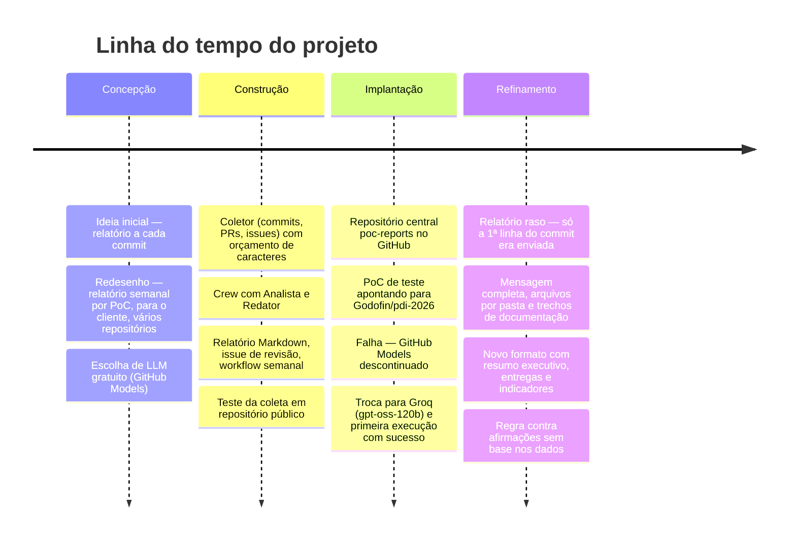

| Etapa | Problema encontrado | Decisão |
|---|---|---|
| Escopo | Um relatório por commit gera ruído e não atende ao cliente | Relatório **semanal por PoC**, em linguagem de status |
| Custo | Começar sem gastar | LLM em tier gratuito + GitHub Actions |
| Privacidade | Código de cliente não deve ir para LLM gratuito | Só metadados e documentação; nunca diff |
| Confiabilidade | LLM pode errar ou inventar | Rascunho + issue de revisão; métricas calculadas pelo código |
| Provedor | GitHub Models descontinuado; modelo Llama removido do Groq | Provedor configurável por variável; Groq + gpt-oss-120b |
| Qualidade | Relatório genérico com só a 1ª linha do commit | Mensagem completa, arquivos alterados e trechos de docs priorizando resultados |
| Fidelidade | O LLM afirmou "disponibilizado ao cliente" sem base | Regra explícita no prompt; sugestões marcadas como "(sugestão)" |

---

## 16. Limitações conhecidas e próximos passos

**Limitações atuais**

- Com muitos documentos alterados na mesma semana, o orçamento por documento fica pequeno e alguns
  resultados podem ficar de fora (caso do p03 no teste).
- O texto varia um pouco entre execuções (o LLM não é determinístico).
- O LLM pode inferir itens "em andamento" a partir de documentos de limitações; a revisão humana corrige.
- O tier gratuito limita o volume: dezenas de PoCs na mesma execução podem estourar o limite diário.
- Só a branch padrão (ou a definida em `branch`) é analisada.

**Evoluções possíveis**

| Evolução | Benefício | Esforço |
|---|---|---|
| Tool `ler_documento` para o Analista | Busca sob demanda o que ficou fora do orçamento | Baixo (mas consome mais tokens) |
| Campo `publico: executivo / tecnico` por PoC | Ajusta o tom para cada cliente | Baixo |
| Exportar PDF/DOCX com a identidade visual da consultoria | Relatório pronto para anexar | Médio |
| Comparar com a semana anterior | Mostrar evolução e itens que mudaram de status | Médio |
| Envio por e-mail/Teams após aprovação na issue | Fecha o ciclo sem passos manuais | Médio |
| Migrar para um provedor pago (ex.: Claude) | Mais contexto, mais qualidade, sem limites apertados | Baixo (só configuração) |
